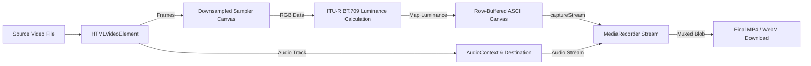

# video-to-ascii 📼

<div align="center">

```text
 _   _ _     _                  _                               _ _ 
| | | (_) __| | ___  ___       | |_ ___         __ _ ___  ___  (_|_)
| | | | |/ _` |/ _ \/ _ \ _____| __/ _ \ _____ / _` / __|/ __| | | |
| |_| | | (_| |  __/ (_) |_____| || (_) |_____| (_| \__ \ (__  | | |
 \___/|_|\__,_|\___|\___/       \__\___/       \__,_|___/\___| |_|_|
```

**Transform any video into retro ASCII art right inside your browser — in real time.**  
*100% client-side. Zero server uploads. Synchronized audio preservation.*

<br/>

[](https://github.com/Ashurai84/video-to-ascii/stargazers)
[](LICENSE)
[](https://react.dev/)
[](https://www.typescriptlang.org/)
[](https://vitejs.dev/)
[](https://tailwindcss.com/)
[](#-privacy--local-first)

<br/>

[**Live Demo**](https://github.com/Ashurai84/video-to-ascii) • [**Quick Start**](#-quick-start) • [**Features**](#-features) • [**Architecture**](#-how-it-works) • [**Contributing**](#-contributing)

</div>

---

## 💡 Why video-to-ascii?

Most video-to-ASCII tools require complex terminal scripts (`ffmpeg`, `jp2a`, Python) or sketchy cloud converters that upload your personal media to external servers.

**video-to-ascii** eliminates all friction:
- 🚀 **Zero installation or cloud dependencies:** Runs entirely in your modern web browser.
- 🔒 **100% Private & Local-First:** Your videos never leave your machine. No telemetry, no backend, no cloud storage.
- 🔊 **Preserves Original Audio:** Unlike basic canvas capture scripts, it routes source audio via the `Web Audio API` so your exported ASCII video has pristine, synced sound.
- 💾 **Native MP4 & WebM Export:** Encodes real-time output streams into shareable video files ready for social media.

---

## ⚡ Comparison

| Feature | `video-to-ascii` | Cloud Converters | Python / CLI Scripts |
| :--- | :---: | :---: | :---: |
| **Privacy / No Uploads** | ✅ **100% Local** | ❌ Sent to Server | ✅ Local |
| **Audio Preservation** | ✅ **Automatic Sync** | ⚠️ Often Muted | ⚠️ Requires FFmpeg Muxing |
| **Real-time Live Preview** | ✅ **Instant Canvas** | ❌ Queue & Wait | ❌ Post-process Only |
| **Setup Required** | ✅ **None (Browser)** | ⚠️ Sign-up / Limits | ❌ Python/C++ Toolchains |
| **Export Formats** | ✅ **MP4 / WebM** | ⚠️ Watermarked / Paid | ✅ Any (via FFmpeg) |
| **Social Aspect Ratios** | ✅ **9:16 / 1:1 / 16:9** | ❌ Fixed | ⚠️ Manual CLI flags |

---

## ✨ Features

### 🎨 Deep Aesthetic Customization
- **Multiple Character Ramps:**
  - `Detailed`: High-fidelity 30-glyph gradient (`@#W$9876543210?!abc;:+=-,._ `)
  - `Classic`: Vintage terminal density (`@%#*+=-:. `)
  - `Blocks`: Heavy unicode shading blocks (`█▓▒░ `)
- **Granular Controls:**
  - **Density Grid:** Scale character size from chunky 8-bit retro vibes to razor-sharp typography.
  - **Brightness & Contrast:** Dynamically lift shadows or crush blacks to fit high-contrast footage.
  - **Color Profiles:** Monochrome White, Cyberpunk Cyan, and high-contrast terminal themes.

### 📐 Ready for Any Platform
- **Original Ratio:** Retains the exact native dimensions of your video (up to 1280px on the longest axis).
- **9:16 Vertical (720×1280):** Perfect for Instagram Reels, TikTok, and YouTube Shorts.
- **1:1 Square (900×900):** Built for feeds and profile showcases.
- **16:9 Landscape (1280×720):** Ideal for widescreen YouTube, desktop, and film presentations.

### 🎬 Production-Grade Recording
- **Variable Frame Rates:** Choose between `15`, `24`, `30`, or buttery-smooth `60 FPS`.
- **Intelligent Codec Fallback:** Auto-detects browser recording support for H.264/AAC MP4, falling back seamlessly to VP9/Opus WebM.
- **Background Tab Protection:** Prevents stuttered exports by guarding against tab throttling during encode.

---

## 🛠️ How It Works



1. **Downsampled Sampling:** A lightweight offscreen canvas samples video frames down to the target character grid resolution.
2. **Perceived Luminance Calculation:** Calculates true luminance for each block using the digital ITU-R BT.709 standard:
   $$\text{Luminance} = 0.2126R + 0.7152G + 0.0722B$$
3. **Glyph Mapping & Row Batching:** Maps brightness values to character glyphs and renders them line-by-line onto the high-resolution output canvas in single string batches for maximum draw call performance.
4. **Synchronized Muxing:** Combines the visual `canvas.captureStream()` with an `AudioContext` media stream node into a native `MediaRecorder` instance.

---

## 🚀 Quick Start

### Prerequisites
- Node.js **22.12** or newer
- npm or pnpm

### Local Setup

```bash
# 1. Clone the repository
git clone https://github.com/Ashurai84/video-to-ascii.git

# 2. Enter the frontend directory
cd video-to-ascii/frontend

# 3. Install dependencies
npm install

# 4. Start the development server
npm run dev
```

Open `http://localhost:5173` in your browser. Drop in any video and start converting!

### Production Checks

```bash
cd frontend
npm run typecheck    # Validate TypeScript strict types
npm test             # Run Vitest test suite
npm run build        # Build optimized production bundle
```

---

## 🔒 Privacy & Local-First

Your data and footage remain entirely your own.
- No remote video processing
- No analytics or user tracking
- No cookies or local storage persistence
- All processing and encoding occurs in ephemeral browser RAM

---

## 🧩 Tech Stack

- **Framework:** [React 19](https://react.dev/)
- **Language:** [TypeScript](https://www.typescriptlang.org/)
- **Bundler:** [Vite](https://vitejs.dev/)
- **Styling:** [Tailwind CSS v4](https://tailwindcss.com/)
- **Testing:** [Vitest](https://vitest.dev/) & [Testing Library](https://testing-library.com/)
- **Core APIs:** HTML5 Canvas, Web Audio API, `MediaRecorder`, `captureStream`

---

## 🤝 Contributing

Contributions, issues, and feature requests are welcome!

1. Fork the project
2. Create your feature branch (`git checkout -b feat/amazing-feature`)
3. Commit your changes (`git commit -m 'feat: add amazing feature'`)
4. Push to the branch (`git push origin feat/amazing-feature`)
5. Open a Pull Request

---

## 📄 License

Distributed under the **MIT License**. See `LICENSE` for more information.

---

<div align="center">

**If you find this project cool or useful, please give it a ⭐ star!**  
*Built for creative developers, retro visual artists, and hackers.*

</div>
